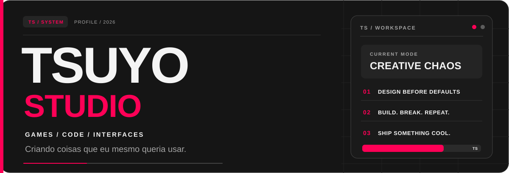
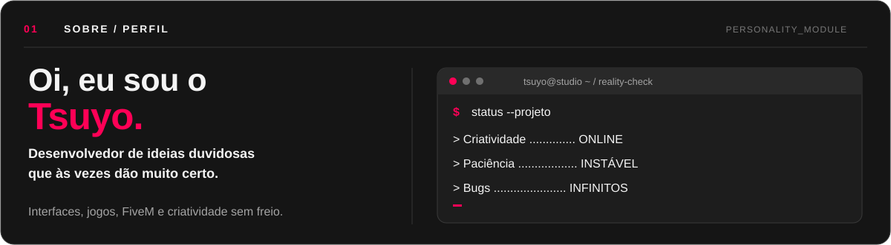
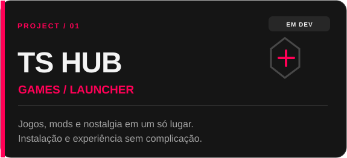
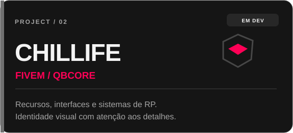
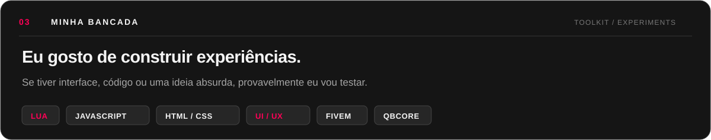
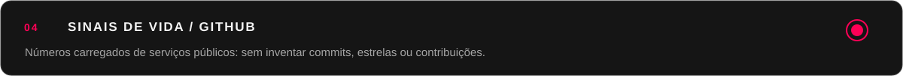
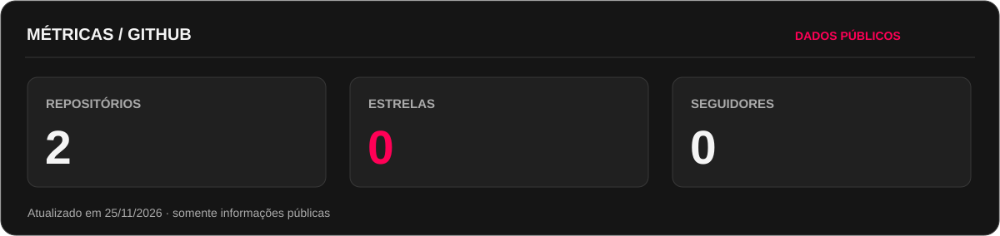
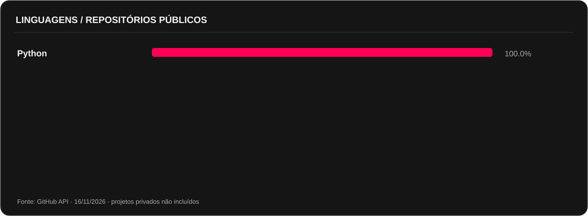
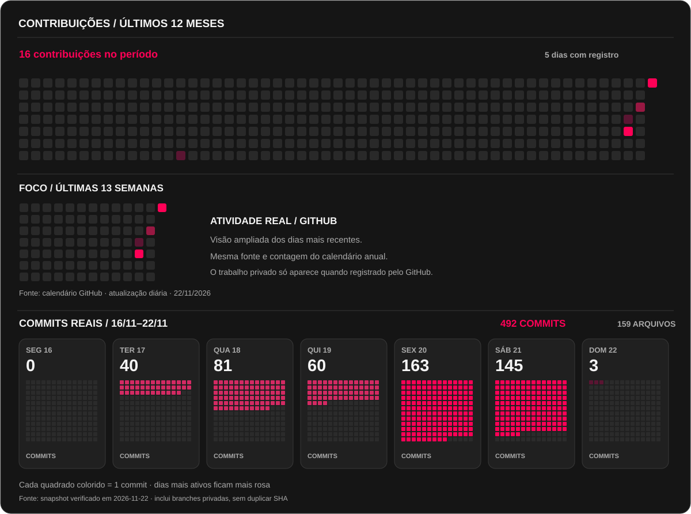
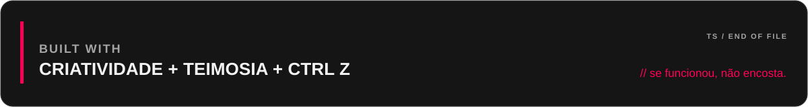

  <a href="https://github.com/TsuyoStudio?tab=repositories">Repositórios</a> &nbsp;·&nbsp;
  <a href="https://github.com/TsuyoStudio/ts-downloads">TS HUB / Downloads</a> &nbsp;·&nbsp;
  <a href="https://github.com/TsuyoStudio?tab=overview">Contribuições</a>

 

<h3>PROJETOS EM CONSTRUÇÃO</h3>

Portfólio de desenvolvimento. O código de alguns projetos é privado; os cards não indicam publicação pública.

  

<h3>O QUE MUDOU RECENTEMENTE</h3>

<strong>TS HUB v0.4.9</strong> · atualização integrada em 21/11/2026

  <strong>Launcher:</strong> catálogo modular em JSON, downloads pelo Google Drive, biblioteca de jogos e navegação com controles Xbox/PlayStation, incluindo teclado virtual e feedback háptico.

  <strong>NFS Underground 2:</strong> edições Original e TS-Version, aviso pré-jogo e Splash com arte 4K, centralização no monitor e exibição mínima de 7 segundos.

  <strong>Social R4:</strong> interface integrada ao launcher, perfis, amizades, mensagens, grupos, Party e chamadas P2P no código; conectividade e mídia ainda em homologação real.

  <strong>Site e identidade:</strong> página de downloads pública, área de autenticação em testes e trabalho contínuo de segurança e privacidade.

Referências: <a href="https://github.com/TsuyoStudio/ts-gamehub/pull/25">integração v0.4.9</a> · <a href="https://github.com/TsuyoStudio/ts-gamehub/blob/main/CHANGELOG.md">CHANGELOG do HUB</a> (repositório privado).

  

<h3>PRÓXIMOS SISTEMAS / EM DESENVOLVIMENTO</h3>

  <strong>TS Bridge:</strong> contrato de eventos, integração do Agent Windows por Named Pipe + SQLite e captura de evidências de corridas.

  <strong>Game Point's:</strong> sistema proposto com 150 conquistas, EXP e progressão de perfil.

Funcionalidades em revisão, não apresentadas como lançadas: <a href="https://github.com/TsuyoStudio/ts-gamehub/pull/18">protocolo #18</a> · <a href="https://github.com/TsuyoStudio/ts-gamehub/pull/24">Agent #24</a> · <a href="https://github.com/TsuyoStudio/ts-gamehub/pull/26">conquistas #26</a> · <a href="https://github.com/TsuyoStudio/ts-gamehub/pull/27">captura #27</a>.

  

  

 

 

O calendário mostra os dias registrados pelo GitHub. A faixa inferior amplia as últimas 13 semanas com mais quadrados visíveis, sem duplicar a contagem. Contribuições privadas dependem das configurações de visibilidade do perfil e das regras do GitHub.

 

Estatísticas geradas pela API do GitHub e salvas neste repositório, com atualização diária pelo GitHub Actions. O gráfico de linguagens considera somente repositórios públicos. Os PRs de projetos privados são acessíveis apenas para quem tem permissão.

  

TStudio ™ | Tsuyo Studio

