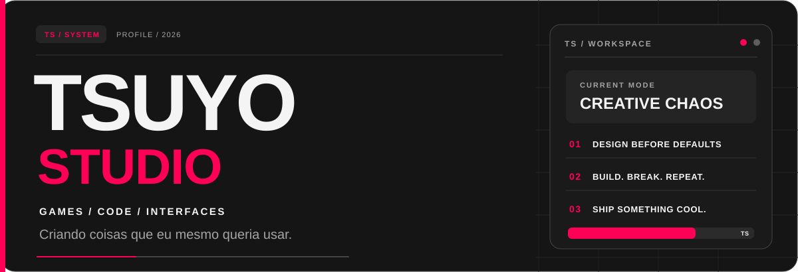
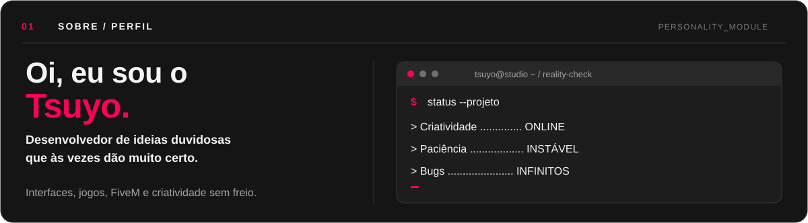
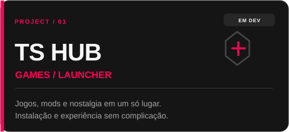
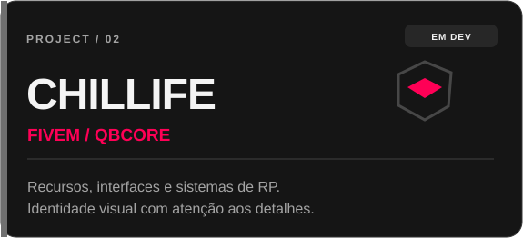
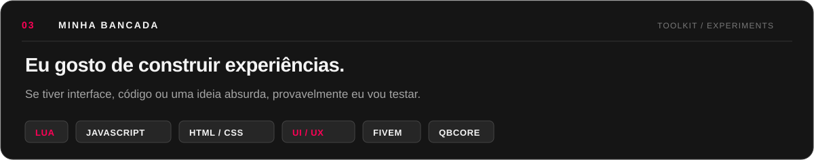
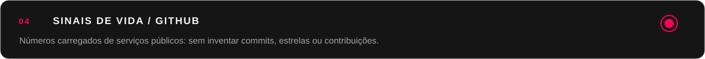
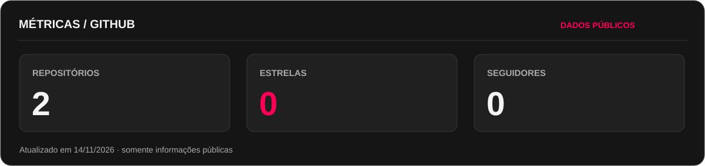
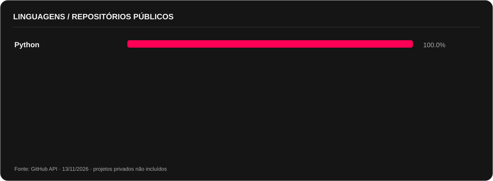
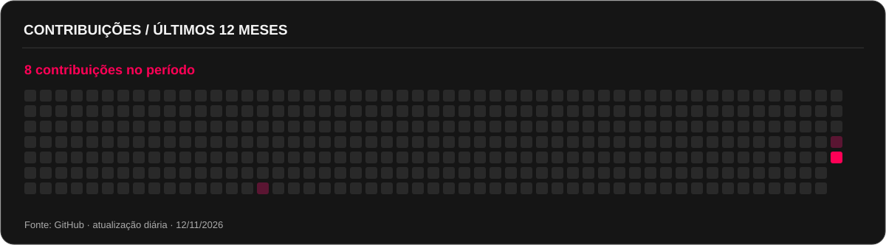
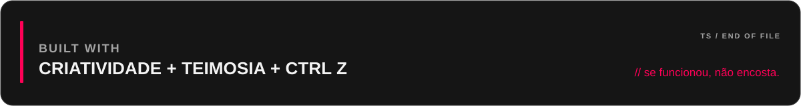

<a href="https://github.com/TsuyoStudio?tab=repositories">Repositórios</a> &nbsp;·&nbsp; <a href="https://github.com/TsuyoStudio?tab=overview">Visão geral</a> &nbsp;·&nbsp; <a href="https://github.com/TsuyoStudio/ts-downloads">Downloads</a>

  

 

### PROJETOS EM CONSTRUÇÃO

 

Projetos exibidos como portfólio. Alguns repositórios ainda são privados ou não foram publicados.

  

 

 

 

Gráficos gerados pela API oficial do GitHub e salvos neste repositório. Atualização automática diária pelo GitHub Actions; repositórios privados não entram no gráfico de linguagens.

  

